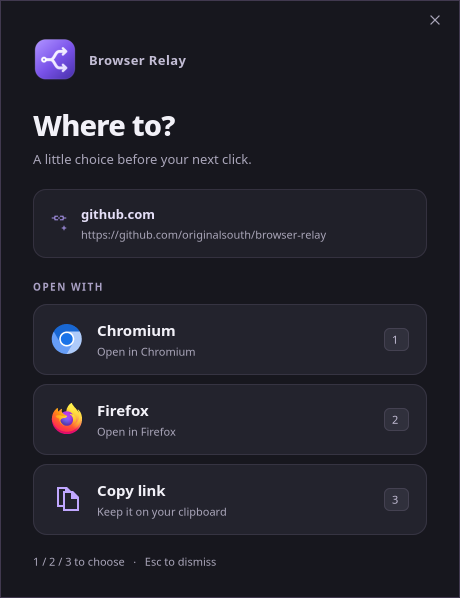

# Browser Relay

**Your link. Your call.**

A small, native Linux app that gives every link a pit stop. Open it in your
favourite browser, copy it, send it to your phone with a QR code, or take a closer
look before you visit. Written in Rust with GTK 4, dressed in dark violet.

[](https://github.com/originalsouth/browser-relay)

## Choose where it goes

- **Your browsers** — automatically finds installed desktop browsers, from Firefox
  and Chromium to Brave, Vivaldi and Flatpak installs.
- **Copy link** — keep it for later, paste it somewhere else.
- **Show QR code** — scan it on another device. Hidden until you ask.
- **Inspect link** — see the connection behind the address.

Click a choice or press its number. **Ctrl+C** copies, **Ctrl+R** shows the QR code,
**Ctrl+I** inspects. **Q/Esc** dismisses the chooser before you make a choice. Works
with `xdg-open` and apps that use your default browser, with an application-menu
entry and a Plasma desktop shortcut too.

## A peek before you click

A familiar-looking address can hide a different destination. **Risk factors**
flag lookalike domains, misleading brand names, fresh certificates and unexpected
redirects. Warnings open up front; expand any finding for the evidence, highlighted
spelling differences and what to check. All assessed on your device.

Certificates, local transparency checks, server location and optional ping charts
share one compact dashboard. Local **Tranco** rankings and **OISD** blocklists add
context, including subdomains.
Want more? Verify log inclusion, browse certificate history, or check WHOIS/RDAP,
VirusTotal and online GeoIP. Each online check is opt-in.


Opening the chooser makes no inspection requests. Inspect contacts the destination,
including the link's path and query; optional services show what they will receive
before you confirm. No telemetry. Rankings and blocklists are clues, not a promise
that a site is safe. [How the checks and privacy controls work →](docs/reference.md#inspection-privacy)

## Get it running

You'll need Rust/Cargo, `pkg-config`, GTK 4 development files (`libgtk-4-dev` on
Debian/Ubuntu; `gtk4` on Arch), Bash and `xdg-utils`. For copying, install `wl-copy`
on Wayland or `xclip`/`xsel` on X11. Bring your own browsers.

```sh
git clone https://github.com/originalsouth/browser-relay.git
cd browser-relay
./install.sh
xdg-open 'https://github.com/originalsouth/browser-relay'
```

The installer builds an optimized release and sets Browser Relay as your default
HTTP/HTTPS handler. Add `--desktop` for a desktop icon, or `--no-default` to try it
without changing your browser preferences. `./uninstall.sh` removes it and restores
saved defaults where Browser Relay is still selected.

For popularity and blocklist results, download the local indexes:

```sh
browser-relay --update-lists
```

GeoIP uses a local MMDB database. Point `BROWSER_RELAY_GEOIP_DB` at yours;
[setup, data sources and developer notes](docs/reference.md) cover the rest.

An **iOS companion is in development**, with native browsing, Share-menu inspection
and the same Rust risk checks. It still needs testing on a Mac and device.
[Build notes and default-browser support →](docs/ios.md)

[MIT licensed](LICENSE). For people who use more than one browser.
