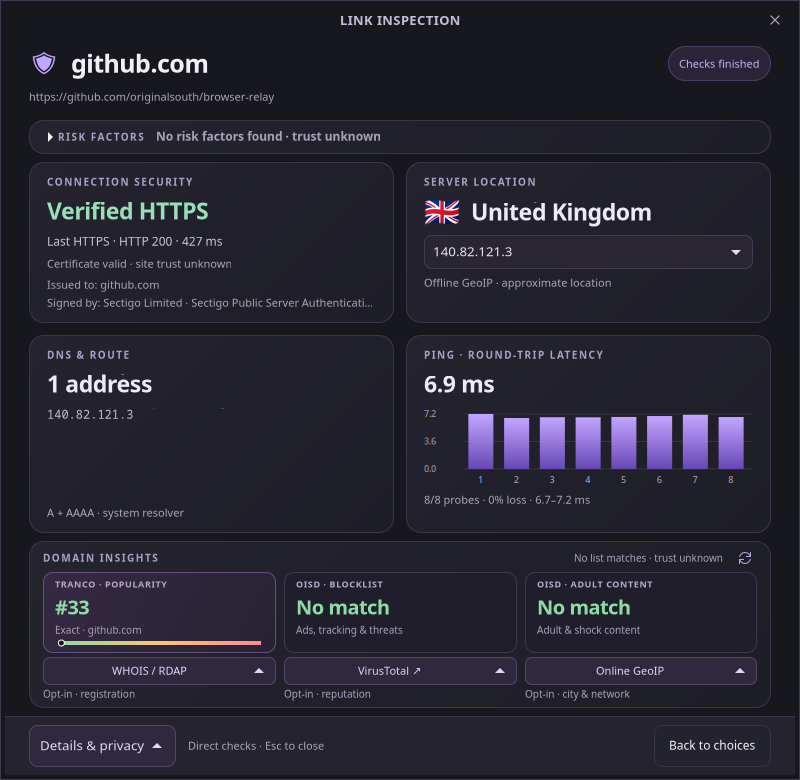

# Reference

[Back to the README](../README.md)

## Using Browser Relay

Choose a button, press its displayed number, or use **Tab** and **Enter**.
The first nine choices have numeric shortcuts; **Ctrl+C** copies, **Ctrl+R** reveals QR,
and **Ctrl+I** inspects regardless of browser count. **Q/Esc** dismisses the chooser unless an open or copy action is still finishing. The dark violet
chooser scrolls for longer browser lists; Copy, QR and Inspect work even when
no browser is installed. A failed launch leaves the chooser open.

**Show QR code** (**Ctrl+R**) reveals a locally generated code for the first link.
It stays hidden until requested; **Esc** or **Hide QR code** dismisses it.
Links over 106 UTF-8 bytes show a warning instead to keep the compact code readable.
Opening and copying still use the complete link.

**Inspect link** (**Ctrl+I**) checks the first link in a compact dashboard: DNS addresses,
HTTP redirects, TLS validation, certificate subject and issuer, connected peers,
local GeoIP with country flags, and eight ping probes per peer. The IP selector
switches location and latency results together. **Details & privacy** opens the
full report; closing the inspector cancels outstanding checks.



Same-origin redirects are automatic; another origin needs confirmation.
The report preserves earlier hops and warnings, with a six-request limit across
the session. HTTPS-to-HTTP downgrades are blocked. Checks use Rust libraries,
not command-line utilities. Ping may be unavailable when the OS restricts ICMP.
HEAD responses can differ from browser visits; scripts and page resources are
not examined. A valid certificate identifies a domain, not a trustworthy site.

**GeoIP stays local.** Set `BROWSER_RELAY_GEOIP_DB` to a GeoLite2/GeoIP2 City or
Country MMDB, or place it at
`${XDG_DATA_HOME:-~/.local/share}/browser-relay/GeoIP-Country.mmdb`.
Standard City/Country filenames in `/usr/share/GeoIP` and `/var/lib/GeoIP` also work.
There is no automatic download, update, or online fallback. Locations are estimates
and may describe a CDN or proxy. [DB-IP Country Lite](https://db-ip.com/db/download/ip-to-country-lite)
is supported; its [CC BY 4.0](https://creativecommons.org/licenses/by/4.0/) license
requires attribution to [DB-IP](https://db-ip.com/).

### Local Tranco and OISD indexes

**Domain insights** combines [Tranco's subdomain-inclusive top million](https://tranco-list.eu/)
with [OISD Big and NSFW](https://oisd.nl/setup). Matching is local:

- **Tranco** shows popularity for the latest inspected hostname, including return
  redirects. Exact ranks take precedence; a parent match is labeled explicitly.
  Popularity is not a whitelist or safety score.
- **OISD Big** mixes ads/tracking with phishing, malware and other threats.
  A match does not identify which category caused it.
- **OISD NSFW** flags adult/shock content separately from malware.
- **No match** means trust is unknown. Missing or invalid indexes show unavailable;
  IP literals cannot be classified by domain lists.

OISD parent-domain rules apply to subdomains, and warnings accumulate across
redirects. Tranco never suppresses them. Hover or open **Details & privacy** for
matched names, rank history, and source dates. Data older than seven days is
marked stale. Use the refresh icon to review the download disclosure, or run:

```sh
browser-relay --update-lists       # Tranco + both OISD lists
browser-relay --update-tranco      # popularity only
browser-relay --update-blocklists  # OISD only
```

Updates download complete lists from `big.oisd.nl`, `nsfw.oisd.nl`, and
`tranco-list.eu`; **no inspected hostname or URL is sent**. There are no automatic
updates. Validated snapshots replace caches atomically; failures retain old data,
and partial update failures are reported. Tranco preserves published ranks when
excluding non-web DNS entries. It covers listed subdomains, not every subdomain.

Caches live in `${XDG_DATA_HOME:-~/.local/share}/browser-relay/` as `oisd.bin` and
`tranco.bin`. `BROWSER_RELAY_OISD_DIR` and `BROWSER_RELAY_TRANCO_DIR` override their
directories. Packed text, 32-bit offsets and binary search keep lookups compact
and allocation-free; validated indexes are shared between checks. Desktop decoding
budgets allocations from the file size (plus at most 1 MB for Tranco rank validation),
rejecting forged lengths before allocating. Files stream directly into index storage.
OISD lists are capped at 32 MiB each, Tranco CSV at 64 MiB; download redirects
and cookies are disabled.

Data is downloaded separately under [OISD's GPL-3.0 license](https://github.com/sjhgvr/oisd/blob/main/LICENSE)
and [Tranco's source data terms](https://tranco-list.eu/), with source dates and
attribution preserved. Neither dataset is bundled with the app.

### Risk factors

The **Risk factors** card shows a compact summary under the URL banner, above
the connection grid. Expand it for the evidence; new warnings open it automatically.
Factors are computed on your device from each attempted URL and the local Tranco
index, before DNS or TLS can fail. Redirect targets are checked only after any
required consent. There is no score, and **none found is not safety**. Each factor
is an expandable row with a severity icon, title and word (`Warning`, `Caution`,
`Notice`), so colour is never the only cue. Warning rows start expanded, the rest
collapsed, and rows you toggle stay as you left them while later hops arrive. Lookalike and near-miss rows show
the link beside the brand with the differing characters highlighted; an IDN is
shown in Unicode with its punycode in the evidence. When any warning exists, the
title shield switches to a warning icon.

| State | Summary |
| --- | --- |
| Before the first result | `Checking the route…` |
| Running, no factors | `Nothing found yet · checking` |
| Running, factors | `1 warning · checking` |
| Finished, route incomplete | `1 warning · route incomplete` or `None in the route so far · trust unknown` |
| Finished, complete, none | `No risk factors found · trust unknown` |
| Finished, complete, factors | `2 warnings · 1 caution` |

| Id | Severity | Meaning |
| --- | --- | --- |
| `lookalike` | Warning | Spelled differently but reads like a top-ranked brand on another domain (TR39 skeleton match) |
| `brand-elsewhere` | Warning | A brand's full address inside another name (`paypal.com.evil.top`), or its name as a hyphenated part of the registered name (`paypal-login.xyz`) |
| `brand-subdomain` | Caution | A brand's name only as a subdomain word of another domain (`gitlab.acme.de`) |
| `near-brand` | Caution | One edit or swap from a brand's name |
| `ip-host` | Caution | Bare public IP instead of a domain name |
| `plain-http` | Caution (Notice if local) | Unencrypted connection |
| `new-certificate` | Caution under 2 days, Notice under 7 | Certificate recently issued |
| `same-name` | Notice | Exactly a brand's name under another ending (`paypal.xyz` for `paypal.com`) |
| `local-address` | Notice | Private, loopback or non-public name |
| `unusual-port` | Notice | Port other than 80 and 443 |
| `shortener` | Notice | Known link shortener |
| `embedded-destination` | Notice | A query parameter holds another web address |
| `cross-site` | Notice | A redirect hands you to a different site |
| `refused` | Notice | The server refused the check, so its content was not observed |

Each row's evidence says why it matters, then what to do. Local destinations get
the gentler `Notice` wording rather than public-internet alarms.

Lookalikes use the Unicode TR39 confusable skeleton
([`unicode-security`](https://crates.io/crates/unicode-security)). A **brand** is
a site in the Tranco top 10,000; only the top 500 are searched for
inside other names (the name must be at least six letters), lookalike matching needs at least four letters, and near-miss matching needs seven or more.
Website boundaries include private hosting suffixes: `alice.github.io` and
`bob.github.io` are separate sites. A destination whose own site ranks in the
top 100,000 is **established** and is never flagged as a lookalike; a hosting
provider's rank gives its tenants no exemption. Certificates valid for ten
days or less (six-day ACME profiles) are ignored for age, since they are always
young. Factors need no network access and no extra requests.

Without a Tranco index the card ends with `Lookalike checks are off · no local
ranking list` and a **Download lists…** button that opens the usual confirmation;
factors recompute after the update. When the inspector closes with any warning or
caution, the chooser's status line carries it over (for example `Inspection: ⚠
paypa1.com imitates paypal.com (+1 more)`); notices alone leave it untouched.

Historical baseline, before the private-hosting boundary fix; these rates need
re-measuring for the current detector. Measured offline on 2026-10-19 with Tranco list `Q2Y54` (2026-10-14). Benign is
every 20th Tranco hostname ranked beyond 100,000 (44,987 URLs); phish is
Phishing.Database's active links (789,054 URLs, parsed as text and never
contacted). Share of URLs with each URL-only factor:

| Factor | Benign | Phishing |
| --- | --- | --- |
| `lookalike` | 0.01% | 0.03% |
| `brand-elsewhere` | 0.07% | 0.96% |
| `brand-subdomain` | 0.03% | 1.02% |
| `near-brand` | 0.40% | 0.46% |
| Any of those four | 0.51% | 2.47% |
| `same-name` | 0.92% | 1.33% |
| `local-address` | 1.83% | 0.08% |
| `ip-host` | not measured (hostnames only) | 1.16% |
| `embedded-destination` | 0.00% | 0.28% |
| `unusual-port` | 0.00% | 0.17% |
| `shortener` | 0.00% | 0.00% |

`same-name` is a Notice because the same name on another ending is often
legitimate (`gitlab.org`, `sony.es`); attackers also use it, so check the address.
`brand-subdomain` is a Caution for the same reason: self-hosted services name
their subdomains after the product (`gitlab.`, `outlook.`, `sentry.`), so a bare
subdomain word is weaker evidence than a brand's whole address (`paypal.com.`)
spelled out in front of someone else's domain, which stays a Warning.

The lookalike-family rate (0.51%, the four factors above) is marginally above the
0.5% target, within sampling error at this sample size; the two Warnings among
them (`lookalike` and `brand-elsewhere`) fire on 0.08% of benign URLs. "Benign" means Tranco-ranked hostnames beyond #100,000,
not real user links, which is why `local-address` appears there.
Re-run with
`cargo test --release --lib evaluate_url_only_factors -- --ignored --nocapture`
(set `BROWSER_RELAY_TRANCO_DIR` and `RISK_EVAL_PHISH`).

### Optional online checks and WHOIS

**WHOIS / RDAP**, **VirusTotal**, and **Online GeoIP** are opt-in. Each button
shows the identifier and destination before sharing anything. Domain checks are
unavailable for proxy/private destinations. Reopen WHOIS or GeoIP to read the
result, or find it in **Details & privacy**.

WHOIS-style registration data uses [RDAP over HTTPS](https://www.icann.org/rdap/).
The public suffix list selects the registered domain locally: `private.example.co.uk`
becomes `example.co.uk`, and `tenant.github.io` becomes `github.io`.
Only that domain is sent to the disclosed registry. Results include registrar,
registrant when disclosed, dates, nameservers, status, and DNSSEC registration
information. Records may be redacted and do not certify site safety.

Registry selection uses the bundled [IANA bootstrap map](https://data.iana.org/rdap/dns.json)
in [`assets/rdap-dns.json`](../assets/rdap-dns.json) (retrieved 2026-10-15, published 2026-09-30), with no runtime
bootstrap request. Maintainers can refresh it from that URL; suffix updates come
through `psl`. Missing HTTPS registry entries show unavailable. Registry addresses
must be public; responses are capped at 1 MiB. No redirects, registrar referrals,
or plaintext WHOIS fallback are followed. This checks the initial domain, not
its redirect destinations.

### Inspection privacy

Reviewed 2026-10-15. Opening the chooser or QR popup makes no inspection requests.
Inspect sends a HEAD request **including the link's path and query** to its
destination. Your resolver sees hostnames; peers see ICMP probes. Fragments are
removed, credentials are rejected, and no cookies or Referer headers are sent.
Another origin requires confirmation.

HTTP honors proxy and NO_PROXY settings. With proxy environment variables present,
separate DNS/ping checks and hostname lookup buttons are disabled to avoid
bypassing the proxy. Online checks exclude private/reserved IPs, local or unknown
namespaces, and names resolving to private addresses. Public IDN names are supported.
Confidential public hostnames cannot always be recognized: review the disclosure.

| Optional action | Information disclosed | Privacy limits |
| --- | --- | --- |
| Update local indexes | Connection IP, request metadata, public list version; **no inspected hostname or URL** | Full lists only on request. [Tranco logs requests](https://tranco-list.eu/privacy_policy). Matching stays offline. |
| WHOIS / RDAP | Registered domain to its authoritative registry | Registry policies vary; domain/IP logging is possible. No bootstrap intermediary or referrals. |
| Online GeoIP | One public connected peer IP | [ipwho.is policy](https://ipwhois.io/privacy) permits usage/IP logging and Cloudflare processing; no fixed retention guarantee is claimed here. |
| VirusTotal report | Initial hostname or public IP, via your browser | Browser cookies, account identity and history may apply. Its [privacy notice](https://cloud.google.com/terms/secops/privacy-notice) covers usage, identifiers and IP addresses. No full URL is submitted for scanning. |

All providers also see your connection IP (or proxy egress) and request metadata.
Optional checks receive no original URL path, query, credentials, or fragment.
Online GeoIP uses HTTPS without redirects or cookies, with a 64 KiB response cap.
Browser report pages can load their own third parties; their retention cannot be
verified by the app. Reports stay in memory, with no telemetry. Missing data,
failed pings, and unranked domains never imply safety.

Multiple links are opened together or copied as newline-separated text. Local
file paths and `file:` URLs work too. Links are passed as separate arguments,
without a shell. The clipboard needs a graphical session even in terminal mode.

Browsers come from the [GIO desktop registry](https://docs.gtk.org/gio/iface.AppInfo.html):
visible applications registered for HTTP or HTTPS, with an available executable
and URL support. User desktop overrides are respected; Browser Relay, indirect
openers and duplicate launches are excluded. Deduplication resolves executable
symlinks and treats `%u`/`%U` alike, while retaining profile and wrapper arguments. Entries are sorted by name, retaining
launch arguments and icons, including exported Flatpak/Snap desktop entries.
Chromium and Firefox also have a PATH fallback if no usable registration exists;
explicitly hidden registrations stay hidden.
Desktop launch commands use GIO's Exec expansion; URL text is never evaluated as a shell command.

`--terminal` and `BROWSER_RELAY_DIALOG=zenity` use the same discovered browsers
and offer copying. In terminal mode, **c** copies and **q** cancels. VirusTotal's
confirmation names its browser: the configured HTTPS handler, the saved pre-relay
handler, then Chromium/Firefox, then another available browser. Browser Relay
itself is excluded. Discovery runs once in a background worker; the chooser stays
responsive while it loads; a discovery failure still leaves Copy, QR and Inspect
available. VirusTotal can recover through a Chromium/Firefox PATH launcher if
discovery failed, while respecting hidden registrations. This fallback is resolved
once on the discovery worker, never while rendering a report. Desktop browser launches
carry a GDK activation context;
the compositor still controls focus.

Existing local files take precedence over ambiguous names such as `notes.md`,
`invoice.zip` or `github.com`; their names are not rewritten into remote hosts.
Use an explicit `https://…` URL to choose the website. Without a matching local
file, recognized public hostnames open over HTTPS and other input retains the
browser's address/search behavior. Copying always keeps the original input.
Empty and relative PATH entries are ignored, including for desktop launch commands.
With PATH unset, lookup uses `/usr/local/bin`, `/usr/bin` and `/bin`.

Domain insight colors describe individual signals: OISD Big matches are red,
adult/shock matches orange, and no matches green. Unknown results stay gray.
Tranco uses `a = atan(2 * (log10(rank) - 5))`, normalized as
`(a - atan(-10)) / (atan(2) - atan(-10))`: #1 is 0 (green), #1,000,000
is 1 (red). The bend is near #100,000; rank #4,821 scores about 0.10 and stays
green. Unranked domains use the red endpoint; missing data and IP addresses
stay gray. Parent-only matches remain unranked/red; the caption shows the parent's
rank as context without using it for the hostname's colour. Stale data is marked;
colors do not establish safety, and popularity never overrides a list warning.

## GTK timing warnings

GTK 4.24.1 can report `Duplicate call to gdk_frame_timings_presented()` on
Wayland when surfaces sharing a frame clock receive different presentation times.
GTK's development branch [reworks that handling](https://github.com/GNOME/gtk/commit/ca28c21845624205b3b1de2175868d3efcf2950d),
including [feedback from multiple Wayland surfaces](https://github.com/GNOME/gtk/commit/2da76eb2c7222a99db5168bc0884668e7cc9ac52).
The fix is not in 4.24.1. Browser Relay keeps these diagnostics visible.

Changing renderer or disabling Wayland presentation feedback did not reliably
avoid the warnings in local testing. `--terminal` bypasses the graphical toolkit
when needed; it offers browser selection and copying.

## Development

Linux's GTK interface and desktop integration live in `main.rs`, `browser.rs`,
`relay.rs`, `ui.rs` and `inspector_ui.rs`. `inspect.rs`, `whois.rs` and
`list_cache.rs` provide Linux transport and storage-location adapters.

`src/lib.rs` exposes the common Rust core: URL rules, redirect consent and limits,
certificate and RDAP parsing, QR generation, GeoIP, packed domain indexes, reputation
assessments and atomic caches. Linux uses it directly; the [iOS app and Share
extension](ios.md) use the C/JSON boundary in `mobile.rs`. UI, clipboard, browser
launching, container paths and network transport stay at the platform boundary.

```sh
cargo fmt --check
cargo clippy --all-targets --all-features -- -D warnings
cargo test
cargo test --no-default-features --features mobile --lib
cargo audit
cargo audit --file fuzz/Cargo.lock
shellcheck install.sh uninstall.sh
cargo build --release --locked
python3 tests/install.py
```

The routing tests use fake executables and a private D-Bus session (`dbus-run-session`);
the installer tests use a temporary home and fake XDG tools. Native GUI tests additionally need Xvfb, xdotool, ImageMagick, and
`zbarimg` (to decode QR codes from the captured windows):

```sh
xvfb-run -a -s '-screen 0 1280x1024x24' python3 tests/gui.py
```

Local TLS/redirect GUI regressions additionally need OpenSSL and Tesseract:

```sh
xvfb-run -a -s '-screen 0 1280x1024x24' python3 tests/inspection.py
xvfb-run -a -s '-screen 0 1280x1024x24' python3 tests/reputation.py
# Offline regressions for cancellation and late lookup results:
xvfb-run -a cargo test slow_discovery_does_not_block_cancellation -- --ignored --test-threads=1
xvfb-run -a cargo test busy_dismissal_and_browser_icon_style -- --ignored --test-threads=1
xvfb-run -a cargo test discovery_failure_keeps_copy_qr_and_inspect -- --ignored --test-threads=1
xvfb-run -a cargo test peer_change_discards_a_late_online_lookup -- --ignored --test-threads=1
```

Check scrollbar geometry with GTK warnings treated as failures (install the
Breeze GTK theme to cover Plasma's theme too):

```sh
GTK_THEME=Breeze G_DEBUG=fatal-warnings GTK_A11Y=none GDK_BACKEND=x11 GSK_RENDERER=cairo \
  xvfb-run -a cargo test scrollbars_have_valid_geometry -- --ignored --test-threads=1
# Repeat with GTK_THEME=Adwaita.
```

The domain-list parser, binary-cache decoder and suffix matcher have a standalone
coverage-guided fuzz target (nightly Rust, `cargo-fuzz`, AddressSanitizer):

```sh
mkdir -p fuzz/corpus/domain_lists
cp fuzz/seeds/* fuzz/corpus/domain_lists/
cargo +nightly fuzz run domain_lists -- -max_total_time=60 -max_len=65536
```

Benchmark the downloaded data without networking or GTK:

```sh
rustc --edition=2024 -O -C lto=fat tools/bench_blocklist.rs -o /tmp/relay-bench
/tmp/relay-bench ~/.local/share/browser-relay/oisd.bin ~/.local/share/browser-relay/tranco.bin
```

For reference, a release microbenchmark on the development machine (2026-10-15)
loaded and validated Tranco list Q2Y54 in 71 ms. Its 999,713 web hostnames occupy
23.62 MiB of packed index storage; 287 non-web entries were excluded without
renumbering ranks. One million warm lookups over five mixed exact/parent/missing
queries took 74 ms (74 ns per lookup). OISD's two indexes occupy another 14.54 MiB.
These are index measurements, not end-to-end inspection times; the OS file cache
may already be warm, and download/parsing memory is higher than steady storage.

The installer always builds with `--release --locked`, fat LTO and one codegen
unit, and installs that build from the repository's target directory. It overrides
conflicting Cargo environment settings for those profile values.

The optional live smoke test is excluded from normal runs. It contacts only
`example.com`, plus an explicit `ipwho.is` lookup using public test
identifiers, and requires a local GeoIP database:

```sh
cargo test live_public_inspection -- --ignored --nocapture
# Separately contact example.com's authoritative registration service:
cargo test whois::tests::live_registry_lookup -- --ignored --nocapture
```

The regular checks do not open your browsers or modify your desktop preferences or
clipboard. The GUI test captures its windows under `/tmp/browser-relay-*.png`.

